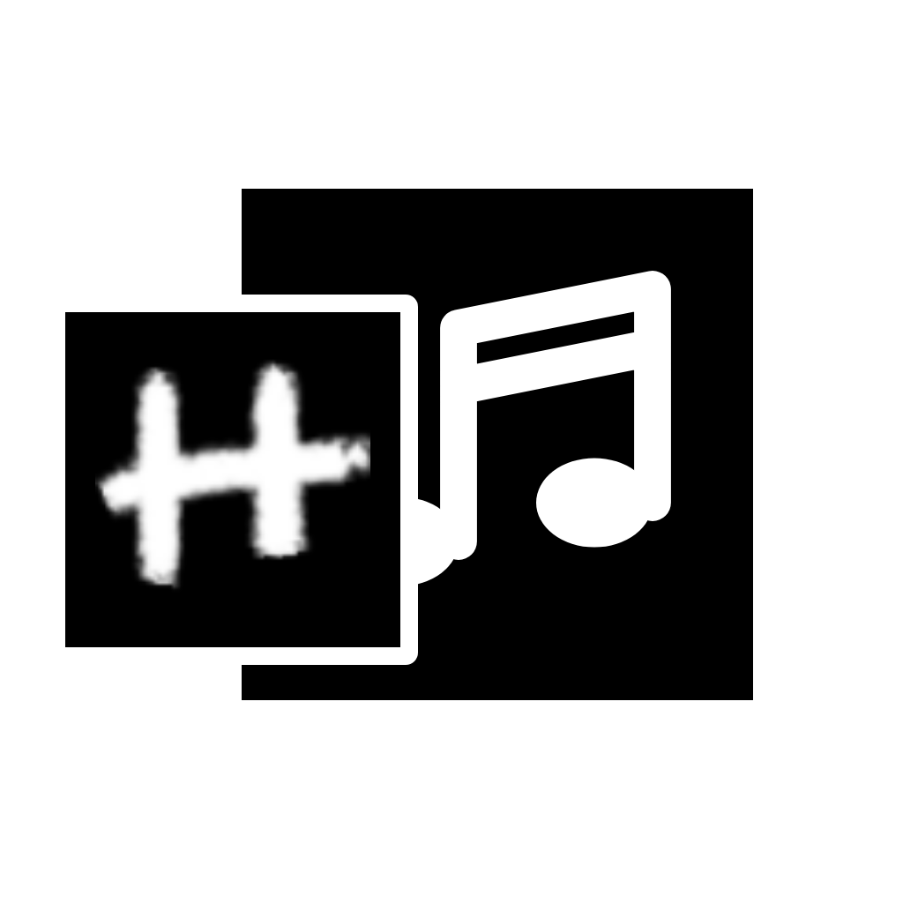
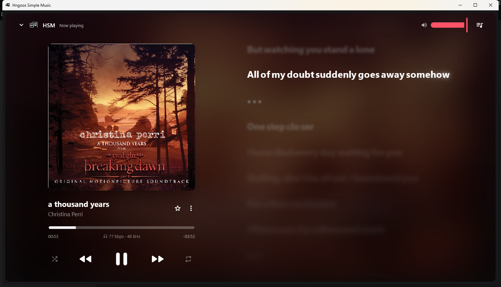

<p align="center"></p>

# Hngoos Simple Music · HSM

An independent desktop music app derived from [SimpMusic](https://github.com/maxrave-dev/SimpMusic), with an Apple Music inspired listening view: large current album artwork on the left, synchronized lyrics on the right.

The active development and distribution target is **Windows x64**. macOS development, CI builds and distribution are temporarily paused; platform source is retained for a possible return. HSM is GPL-3.0 software. See [source provenance](UPSTREAM.md) and [third-party notices](THIRD_PARTY_NOTICES.md).



## Listening

- Search and stream through the upstream YouTube / YouTube Music engine.
- Use existing queue, shuffle, repeat, favorites, downloads, synchronized lyrics and lyric seeking.
- Import MP3, M4A, AAC, FLAC, WAV, OGG, Opus, AIFF or WMA from Library. HSM copies each file into `~/.hsm/library` for playback even if the original moves. Files named `Artist - Title.ext` provide the initial display metadata.
- HSM uses its own `~/.hsm` data directory and `hsm://` protocol.

Track availability depends on YouTube and the listener's region. Spotify and Apple Music are playlist metadata sources: importing does not stream audio from those services or guarantee that every recording has a YouTube equivalent.

## Bringing playlists into HSM

Open **Library → Import playlist or audio** (also available in Settings).

| Source | Import route |
| --- | --- |
| YouTube / YouTube Music | Sign in to YouTube in HSM to access your playlists in Library, or import a converted SimpMusic JSON playlist. |
| Spotify | Import a CSV export containing `Track Name`, `Artist Name(s)`, optionally `Album Name`, `Duration (ms)` and `Track URI`. |
| Apple Music / iTunes | Export a playlist as a text file, then import the TSV. `Name`, `Artist`, `Album` and `Total Time` are supported, including UTF-16 exports. |
| Existing SimpMusic | Import converted JSON using the [upstream format](docs/import-format-v1.md). |

Spotify does not provide CSV export directly in every client; use a playlist export tool you trust. This version does not implement Spotify/Apple account OAuth or arbitrary private playlist URLs. Native YouTube account integration remains upstream functionality.

HSM matches exported titles, artists and duration to YouTube recordings conservatively. It preserves order, duplicates and unmatched entries. The import result reports missing matches and network lookup failures. Select an unmatched entry to search for a recording, add the desired result to the playlist and remove the original placeholder when ready. Play All skips unmatched entries. Cancellation stops further work; already committed import batches can remain.

Playlist documents are limited to 20 MB and 10,000 tracks. Audio is copied with streaming I/O. Local imports currently derive metadata from the filename; embedded artwork/tag editing and folder scanning are future work.

## Build

Use JDK 21 or newer and the Gradle wrapper. All modified core source is included; no submodule checkout is necessary. The build downloads pinned dependencies and verified native playback libraries, so the initial build needs network access.

Windows PowerShell:

```powershell
.\gradlew.bat :domain:jvmTest
.\gradlew.bat :composeApp:mpvSetupAll -PhsmNativeTargets=windows-x64
.\gradlew.bat :desktopApp:run
.\gradlew.bat :desktopApp:packageMsi
```

MSI packaging requires WiX Toolset 3 on PATH.

Build outputs are under `desktopApp/build/compose/binaries/main`. `.github/workflows/desktop.yml` verifies tests and creates the installer on a native Windows runner. Tags `v*` create a **draft** release after the Windows build succeeds. macOS jobs and DMG release uploads are disabled. See [verification status](docs/VERIFICATION.md).

Official installer signing is not configured. The project does not require upstream Sentry or Last.fm secrets (`isFullBuild=false`). Other platform modules remain in the source tree but are outside the active distribution target.

## Development layout

The owner's local workspace has sibling `dev-hngoos-simple-music` and `repo-hngoos-simple-music` directories. This repository is self-contained; those wrapper directories are not required to build it.

The HDM-derived HSM logo is reproduced by `scripts/build-hsm-branding.py` (Python, Pillow, Playwright Chromium). Kotlin namespaces are retained from upstream to keep serialized types and resources compatible. Distribution identity, files, updates and branding are HSM-specific.

HSM is independently maintained by hngoos and is not affiliated with Apple, Spotify, Google or the SimpMusic project. Please report HSM-specific issues in this repository.
